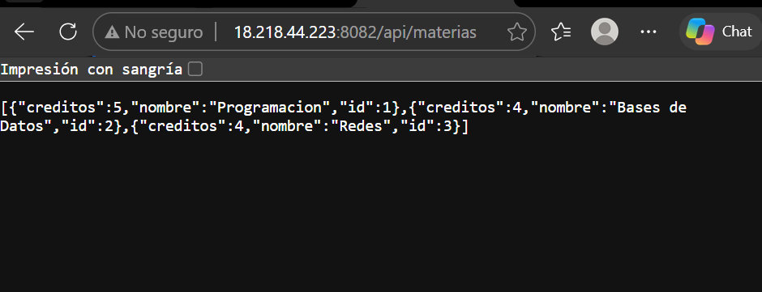
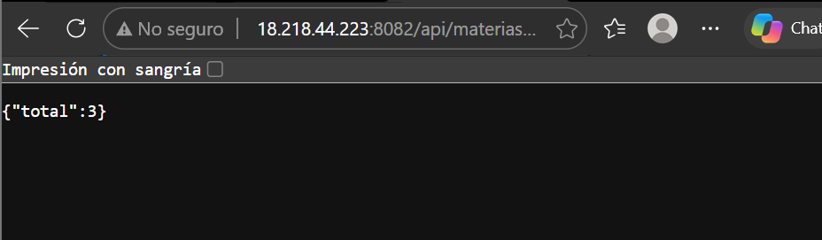

# Actividad 1 - Introducción a Spring Boot

## Descripción

El proyecto consiste en el desarrollo de una aplicación utilizando Spring Boot, con el propósito de conocer su configuración inicial, crear controladores y gestionar solicitudes HTTP mediante endpoints.

También se realizó la ejecución local del proyecto y su despliegue en un servidor virtual mediante AWS EC2.

## Tecnologías utilizadas

- Java 23
- Spring Boot 4.1.2
- Maven
- Spring Web
- Visual Studio Code
- Git y GitHub
- AWS EC2

## Requisitos

- JDK instalado.
- Maven Wrapper incluido en el proyecto.
- Visual Studio Code o un IDE compatible.
- Conexión a Internet.

## Instalación y ejecución local

1. Clonar el repositorio:

   ```bash
   git clone https://github.com/Karl335-lm/MBKact1_t4.git
   ```

2. Entrar a la carpeta del proyecto:

   ```bash
   cd MBKact1_t4
   ```

3. Ejecutar la aplicación:

   ```bash
   ./mvnw spring-boot:run
   ```

4. Abrir el navegador y acceder al endpoint:

   ```text
   http://localhost:8082/api/materias/total
   ```

## Endpoint

| Método HTTP | Endpoint | Descripción |
|---|---|---|
| GET | `/api/materias/total` | Obtiene el total de materias registradas. |

## Despliegue en VPS

La aplicación se desplegó en una instancia de Amazon EC2 utilizando Amazon Linux 2023 y Java OpenJDK 21.

Se configuró el puerto 8082 para ejecutar la aplicación en el servidor.

**Endpoint del VPS:**

```text
http://18.218.44.223:8082/api/materias/total
```

## Evidencias

### 1. Ejecución local

Captura de la aplicación ejecutándose correctamente en el entorno local.
Captura del resultado obtenido al consultar el endpoint de materias.



### 2. Despliegue en VPS

Captura de la aplicación ejecutándose en el servidor EC2.



## Autor

Karla Martinez Bautista

## Repositorio de GitHub

https://github.com/Karl335-lm/MBKact1_t4